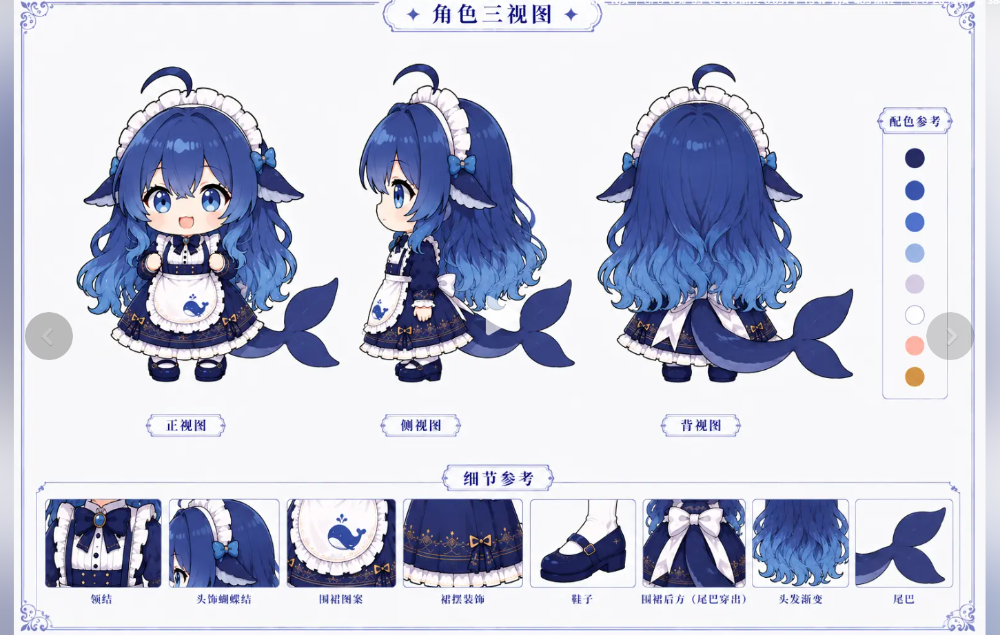

# DeepSeek 桌宠 1.0

一个**从零重做**的桌面宠物：待机、视线、被抓、下落、落地、睡着、惊醒、表情、
点击动作 —— 全部由**本机 MiniMax-H3 视频模型 + 你自己的自用工作流**生成，
同一个参考图、同一个 seed，所以**整套素材是同一个角色**。



```bat
:: 启动（无黑框，推荐）
双击 启动桌宠.vbs
:: 或者带控制台看日志
python pet\main.py
```

---

## 和"上一版"最本质的区别

上一版的待机是一个**静态精灵**（从三视图里裁出来的 PNG），动作是模型重新演绎的。
把两张图并排放在一起就能看出来：**那不是同一个角色** ——
发型长度、头顶月牙的大小、体型、裙摆宽度全都不一样。

```
上一版：  待机 = 三视图裁的静态图      动作 = 模型重演    ← 两张脸，硬切
这一版：  待机 = 模型出的 idle 循环    动作 = 模型重演    ← 同一套素材、同一个 seed
```

这一版把**待机也交给视频模型出**，而且和动作共用参考图与 seed。
验证过：新生成的 `idle` 和之前的点击动作并排看，月牙发饰、发长、轮廓完全一致。

### 还有这些"人工桌宠才有"的东西

| 特征 | 上一版 | 这一版 |
| --- | --- | --- |
| 待机 | 一张静态图上下平移 | **56 帧真动画**：呼吸、发梢/裙摆/尾巴延迟摆动、自然眨眼 |
| 视线跟随 | 无 | 鼠标在左/右/上，**头和眼睛真的转过去**（3 个独立循环片段） |
| 拖拽 | 直接搬窗口 | **被拎起来**悬空晃（独立片段）+ 松手**自由落体 → 落地压扁回弹 → 站好** |
| 影子 | 固定大小 | **随离地高度变小变淡**（被抓起来时特别明显） |
| 气泡头像 | 静态图 | **会眨眼**，而且和角色同一套素材 |
| 状态机 | 只有"播/不播" | IDLE / ACTING / HELD / FALLING / LANDING / ASLEEP / WAKING / EMOTE |
| 久无交互 | 什么都不做 | 先自己卖个萌（45s），再睡着（90s），点一下会**惊醒** |
| 一致性 | 待机与动作是两个人 | 全片段同源，切换不换脸 |

---

## 操作方式

| 操作 | 效果 |
| --- | --- |
| 左键单击角色 / 气泡 | 第 1 次查 DeepSeek 余额，之后依次念台词，并随机播一个点击动作 |
| **按住拖动** | 被拎起来（她会悬空晃）；松手**自由落体**，落地压扁回弹 |
| **移动鼠标** | 她的头和眼睛跟着你转（左 / 右 / 上看） |
| 长时间不理她 | 45 秒自己卖个萌，90 秒睡着；点一下会惊醒 |
| 右键 | 菜单：刷新余额 / 换一句话 / 随便做个动作 / 让她睡一会儿 / 编辑话语 / 设置 / 退出 |
| `Esc` | 退出 |

> 没有任务栏按钮、没有标题栏，**退出请用右键菜单**。

---

## 台词怎么改

打开 `dialogue.txt`（右键菜单"编辑话语文本"也能打开）：

```
# 这是注释，不会显示
欢迎回来～我是深海来的小鲸鱼女仆。

[act_wave]          ← 播到这个片段时优先说这一段
欢迎回来～我挥两只手给你看！

[held]              ← 被拎起来时说的话
呀——放我下来！
```

- **一行一句**，空行和 `#` 开头的行会被忽略。
- **保存即生效**，不用重启。
- `[片段名]` 段落让**台词和动作对得上** —— 被拎起来就说"放我下来"，
  睡着被点就说"我没睡"。
- 片段名在 `assets/actions/` 下能看到（`idle` / `held` / `cheer` / `act_wave` …）。

## 余额显示怎么改

设置窗口里的"余额显示文案"支持这些字段：

`{total_balance}` `{granted_balance}` `{topped_up_balance}` `{currency}`
`{is_available}` `{count}`

---

## 素材是怎么生成的

用的是**同一个模型 + 你自己那份工作流**：
`F:\DeepSeek Work Part\minimax h3（New）` 的 ComfyUI MiniMax-H3（ref2v），
参数逐节点对齐 `自用minimax h3工作流（改自黑鹤001大佬）.json`。

| 工作流节点 | 参数 |
| --- | --- |
| `8 ResolutionSelector` | 9:16 / 0.4MP / ×32 → **608×1088** |
| `18 CLIPLoader` | `qwen3vl_32b_minimax_h3_int8_convrot` |
| `20 UNETLoader` | `h3\minimax_h3_fl2va_pruned_int8_convrot` |
| `21 LoraLoaderModelOnly` | `fl2v_turbo_4step_v1.0_768p`，强度 1.0 |
| `22 SageAttentionPatch` | 内存优化注意力 |
| `10 / 13` | `res_multistep` / `simple` / **4 步** |
| `40 ComfyMathExpression` | 秒数→帧数吸附公式 → **56 帧 @24fps = 2.33s** |

出片约 **192 秒/条**。16 个片段 ≈ 50 分钟。

```bat
:: 前置：ComfyUI 在跑（不在就双击 minimax h3（New）\启动ComfyUI（修复版）.bat）

:: 出一个片段验证通路
python tools\generate_mmx_comfy.py --style pet --actions idle --seed 20240918

:: 一次把整套做出来
python tools\generate_mmx_comfy.py --style pet --actions all --seed 20240918

:: 只换抠像参数、不重出片
python tools\generate_mmx_comfy.py --style pet --actions all --reprocess-only
```

### 片段清单（`tools/action_presets_pet.py`）

| 片段 | 数量 | 循环 | 用途 |
| --- | --- | --- | --- |
| `idle` | 1 | ✅ | 待机主循环：呼吸 + 眨眼 + 发梢摆动 |
| `gaze_left/right/up` | 3 | ✅ | 视线跟随（保持住不转回来） |
| `held` | 1 | ✅ | 被拎起来悬空晃（锚点=居中） |
| `falling` | 1 | ✅ | 下落中，头发裙摆向上翻飞（锚点=居中） |
| `landing` | 1 | — | 落地压扁 → 弹起拉长 → 站好 |
| `asleep` / `waking` | 2 | ✅/— | 睡着点头 / 猛地惊醒 |
| `cheer` / `shy` / `gasp` | 3 | — | 开心蹦 / 害羞捂脸 / 吓一跳 |
| `act_*` | 9 | ✅ | 点击动作（从 v1 搬来，同参考图同 seed，画风一致） |

> **风格段落一个字都没重写**：`action_presets_pet.py` 直接 import
> `action_presets_2dcute` 的 `CHARACTER` / `STYLE_2D` / `RULES` / `FACE` /
> `BOUNCE` / `SMOOTH`。描述画风的那几段改一个字，出来的角色就可能变样。

---

## 自测 / 实测

```bat
:: 【核心】帧间隔 + 点击响应 + 状态切换 + 视线 + 拖拽物理，一次全测
python tools\verify_v2.py

python tools\verify_v2.py --quick      :: 只测帧间隔和点击响应
python tools\audit_smoothness.py --actions idle    :: 素材本身的帧间连续性
python tools\shot.py 深海小女仆 live   :: 截正在运行的桌宠（真实合成像素）
python tools\diag_env.py               :: 屏幕 / DPI / 透明色键诊断
```

### `verify_v2.py` 的判据

| 项 | 健康值 | 本机实测 |
| --- | --- | --- |
| 帧间隔 均值 | 24fps → 41.7ms | **41.7ms** |
| 帧间隔 标准差 | < 8ms（**这才是肉眼说的"抖"**） | **1.1ms** |
| 长停顿（> 2× 理想值） | 0 次 | **0 次**（21/21 片段） |
| 真实点击响应 | < 120ms | **16ms**（最差 28） |
| 状态切换 | 12 个状态都能切 | **12/12** |
| 视线跟随 | 左/右/上都能转头 | **4/4** |
| 落地时脚部与地面差 | ≤ 6px | **1px** |
| 点击命中（身上 200 点） | 全中 | **200/200** |
| 点击命中（身外 200 点误判） | 0 | **0** |
| 切片段时脚底漂移 | ≤ 1px | **0px** |

### 点击稳定性专项（`tools\diagnose_click.py`）

"点击后定位不准 + 卡顿"是这条命令查出来的（三个独立原因，详见
[`制作记录.md`](制作记录.md) 第三节之二）：

| 指标 | 修前 | 修后 |
| --- | --- | --- |
| 角色中线偏移极差 | 5 ~ 8 px | **0 px** |
| 角色底边偏移极差 | 144 ~ 180 px | **0 px** |
| 一次点击里的窗口几何变化 | 2 次 | **0 次** |
| 首帧间隔 | **367 ms** | **46 ms** |

```bat
python tools\diagnose_click.py            :: 点 4 次，量每次的定位与帧间隔
python tools\diagnose_click.py --screen   :: 额外用真截图盯住角色的屏幕位置（含过渡帧）
python tools\diagnose_click.py --rounds 8
```

> **`--screen` 一定别省。** 在播放器回调里量坐标，正片帧和过渡帧是两套
> 坐标系、各自看都自洽 —— 曾经有个"点击时角色往下跳 175px"的 bug，
> 就是这么被漏掉的（详见 [`制作记录.md`](制作记录.md) 三之三）。
> 只有看**屏幕上的像素**才量得出来。

### 资源占用

| 项 | 实测 | 怎么省 |
| --- | --- | --- |
| 内存 | 686 MB | `pet_config.json` 里 `preload_keep` 调到 6~8（→ 约 300MB，代价：偶尔要用到没常驻的片段时先保持当前姿势约 0.8s） |
| 待机 CPU | 5 ~ 7%（单核） | 主要花在"24fps 更新透明色键分层窗口"（约 3.6ms/次全窗口重组），是真动画的固有成本 |

> 内存账：一个片段 56 帧 × 约 380×380 × 4B ≈ 32MB，21 个片段约 680MB。
> 全部常驻是为了**切换零等待** —— 少热一个就可能在切过去时先愣 0.8 秒。

---

## 目录结构

```
desktop-pet-v2/
├─ 启动桌宠.vbs / .bat      静默启动 / 带控制台启动
├─ pet/                     应用（新架构）
│  ├─ main.py               入口
│  ├─ app.py                窗口 / 状态机 / 物理 / 视线 / 事件
│  ├─ anim.py               动画引擎：绝对时间轴推帧 + 交叉淡入
│  ├─ clips.py              素材库：加载 / 缩放 / 对齐 / 后台预热 + LRU
│  ├─ bubble.py             气泡折行排版 + 会眨眼的头像 + 柔和投影
│  ├─ net.py                DeepSeek 余额接口
│  ├─ config.py             配置与台词本
│  └─ settings_win.py       设置窗口
├─ assets/
│  ├─ actions/<片段>/        生成的素材（frames/*.png + action.json）
│  └─ source/               角色三视图、视频缓存、预览、截图
├─ tools/                   生成与验证（沿用同一个管道）
└─ 自用工作流（参考）.json
```

---

## 几个实现上的关键点（改代码前先看）

1. **锚点分两种**：`floor`（脚踩地面：待机/动作/睡着/落地…）和
   `center`（悬空：被抓/下落）。被抓的姿势如果也按脚对齐，悬空感就没了。
2. **`_clip_origin` 返回的是"相对身体区"的落点**，画的时候必须加
   `body_origin`。忘了加，角色会跑到窗口左上角压在气泡上 ——
   看起来像"气泡太大"，其实根因在这儿。
3. **`content_h`（角色目标高度）和 `body_h`（身体区高度）是两回事**，
   共用会把缩放系数搞漂。
4. **布局全部用画布像素**，不要再乘 dpr；进程是 DPI 感知的，
   屏幕尺寸本身就是物理像素，乘两次会放大一倍多。
5. **透明色键是自动挑的**：角色暗部一直渐变到接近纯黑，
   写死的深色键容易正好撞上，Tk 的 `-transparentcolor` 是精确匹配，
   撞上就是把角色挖出一串洞。
6. **预热缓存按时间预算转 Tk 对象**（每轮约 10ms）。一张
   `ImageTk.PhotoImage` 实测 7ms，固定"每轮 6 张"会把主循环拖到 10Hz。
7. **`cache.request()` 必须过滤掉"已经在处理/已经好了"的名字**。
   视线跟随每帧都会请求一次，不过滤的话后台会一遍遍重建同一个正在载入的
   片段、主线程把载入进度重置回 0 —— 片段永远热不完，主循环还被拖垮。
   这是本项目最坑的一个 bug，详见 [`制作记录.md`](制作记录.md) 第 3.6 节。
8. **角色大小要人工校准**（`assets/size_fix.json`）。模型在姿势差异大的片段
   （被抓、下落）里会把她画小，实测只有 74% / 68%；而"按内容高度缩放"
   完全看不出来，因为头发和四肢把画面撑满了。
9. **窗口尺寸必须算死、不随文字变**。桌宠是透明色键分层窗口，改一次尺寸
   Windows 就重组一次整个窗口，还要挪窗口去补偿"脚不动"。以前"气泡几行、
   窗口就多高"，一次点击会重排两次 —— 首帧卡 367ms，位置还有取整误差。
   现在宽度按最大气泡宽、高度按"可能出现过的最长文本"预留行数，
   气泡底边固定在同一个 y。详见 [`制作记录.md`](制作记录.md) 3.10。
10. **屏幕边界要按角色夹，不是按窗口夹**。窗口比角色大得多，
    按窗口夹会把她拖到角色中心 x=2102（屏幕才 1920）——整个人挂在屏幕外。
    竖直方向同理：按窗口夹会让她站不到地面上（被顶高 83px、影子缩一半）。
11. **坐标只有一套：绝对画布坐标**。正片帧的落点本来是"相对身体区"的，
    过渡帧是绝对的；`_draw_body()` 曾经给两者都加 `body_origin`，
    于是过渡帧被加两次 —— **一点击角色先往下跳 175px 再弹回**。
    现在由 `enter()` 统一把相对落点转成绝对值，播放器和绘制全程只认绝对坐标。

## 相关文档

- **[`制作记录.md`](制作记录.md)** —— 为什么这么做、"人工制作"强在哪、
  十几个坑的定位与修法、完整实测数据。**改代码前先翻它。**
  - 第三节之二：点击后"定位不准 + 卡顿"的三个原因。
  - 第三节之三：点击时"角色往下跳 175px"—— 以及它为什么被自己的测试藏住了。
- 上一版的记录：`../desktop-pet/流畅度改造记录.md`（帧间隔/预热/时基的经验来源）
